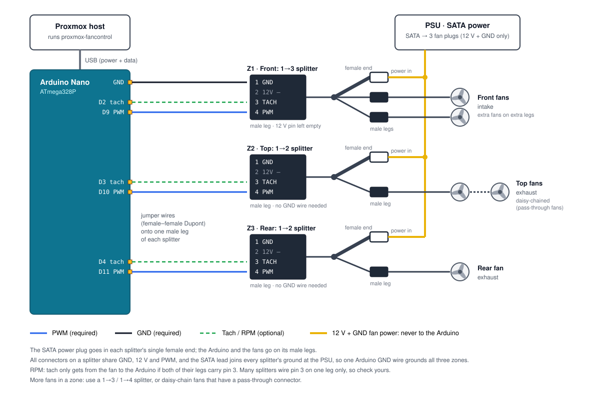

# Proxmox Fan Control

[](https://github.com/bristolpie/ProxmoxFanControl/actions/workflows/build.yml)

Temperature-driven fan control for a Proxmox / ZFS server, using an Arduino Nano as a 3-zone 25 kHz PWM controller over USB. Includes a web dashboard for live temps, fan speeds, history graphs, curve editing and manual overrides.

## Why

Many home servers are built from ex-office PCs, such as a Dell OptiPlex SFF board moved into a bigger case with a stack of hard drives for ZFS. These boards usually have one fan header, for the CPU cooler, and the BIOS controls it with no way to change it. Any case fans you add either run flat out all the time (loud) or at a fixed slow speed (drives run hot, especially during a multi-hour ZFS scrub). The usual Linux tools (`fancontrol`, `lm-sensors`) can't help, because they can only drive fans plugged into the motherboard.

This project adds the missing fan controller. An Arduino Nano (a few pounds) plugged into a USB port drives up to three zones of standard 4-pin PWM fans. A small service on the Proxmox host reads the drive and CPU temperatures and sets the fan speeds from curves you choose. Front fans can follow the hottest drive in the pool, exhaust fans can speed up when the CPU is working hard, and everything runs faster while a scrub is in progress. It's tuned for storage servers, but works on any Linux machine where the motherboard can't control the case fans.

> [!WARNING]
> **Use at your own risk.** This software controls the cooling of your server. A wiring mistake, a bad fan curve or a bug can let drives or the CPU overheat, or damage the Arduino, the fans or the host. It comes with no warranty (see [LICENSE](LICENSE)).
>
> - **Never connect the fans' 12 V wire to the Arduino.** Only ground, PWM and (optionally) tach go to the Arduino. 12 V on any Arduino pin will destroy it, and can damage the USB port it's plugged into.
> - **Watch the temperatures after any change.** Keep an eye on the dashboard for the first few hours after installing, rewiring or editing a curve, and during your first scrub.
> - **Know your hardware's limits.** Check your drives' and CPU's maximum operating temperatures, and set the emergency thresholds in **Settings → Safety** below them.
>
> The design leans towards cooling: if the service stops or the host hangs, the Arduino's watchdog raises every fan to a safe speed after 30 s, and most 4-pin fans run at full speed if their PWM wire comes loose. If the Arduino itself loses power (e.g. its USB cable is pulled), what the fans do depends on the fans, so don't rely on it. These are safety nets, not guarantees.


- **Sensors found automatically.** CPU, every disk, NVMe drives, motherboard and GPU sensors (whatever the kernel exposes), plus combined sensors such as "hottest disk" and "hottest disk in ZFS pool `tank`".
- **Named curves, 3 fan zones.** Make as many curves as you like, each reading any sensor. Each zone follows one curve, so several fans can share a curve or be tuned separately.
- **Hysteresis, rolling averages and cross-zone floors.** Fans don't hunt up and down, and a hot sensor elsewhere can raise a zone's minimum speed (e.g. hot disks lift the CPU fans).
- **Profiles.** `normal`, and a `scrub` profile that switches on automatically during a ZFS scrub or resilver.
- **Safety.** Emergency temperature thresholds put every fan at full speed, even over a manual setting. A sensor that can't be read falls back to a safe PWM. The Arduino ramps the fans up on its own if the host goes silent (watchdog).
- **Web UI.** Live dashboard, 24 h history, a drag-and-drop curve editor, per-zone manual hold with timeout, and settings.
- **Fan RPM.** Optional, from the fans' tach wires. Turn it on per zone in **Settings → Zones → RPM wired**.
- **No dependencies.** Python 3 standard library only, which Proxmox already has. Also exposes a JSON API and a Prometheus `/metrics` endpoint.


---

## Quick install

On the Proxmox host, as root:

```bash
git clone https://github.com/bristolpie/ProxmoxFanControl.git
cd ProxmoxFanControl
./install.sh          # install the service + web UI, and flash the Arduino if needed
```

Then open `http://<proxmox-ip>:8090/`.

The installer:

1. Checks for `python3`, `smartctl` and a CPU hwmon sensor. It offers to install `smartmontools` if it's missing.
2. Finds the Arduino under `/dev/serial/by-id/…`, which is more stable than `/dev/ttyUSB0`.
3. Checks whether another program already holds that serial port and offers to stop and disable its systemd service. Only one program can talk to the Arduino.
4. Copies the program to `/opt/proxmox-fancontrol/` and creates `/etc/proxmox-fancontrol/config.json`.
5. Installs, enables and starts `proxmox-fancontrol.service`, then checks that it responds.
6. Asks the Arduino for its firmware version. If it's older than the one in this release (or too old to say), it offers to flash it with `flash.sh --release`, and falls back to building from source if the download fails.

Re-run `./install.sh` after a `git pull` to upgrade. Your config is kept, and you'll be offered a flash only when the firmware has changed.

| Command | Does |
|---|---|
| `./install.sh --port 9000` | Use a different web port (first install only) |
| `./install.sh --yes` | Don't ask any questions (never flashes; prints the command if a flash is needed) |
| `./install.sh --uninstall` | Remove the service and program, keep the config |
| `./install.sh --uninstall --purge` | Also remove the config and history |

Day to day:

```bash
systemctl status proxmox-fancontrol
journalctl -u proxmox-fancontrol -f        # one status line per minute, plus any changes
curl -s localhost:8090/api/status | python3 -m json.tool
```

## Flashing the Arduino

You can flash the Arduino straight from the Proxmox host over the same USB cable. You don't need to unplug it or use another PC. `flash.sh` stops the service, flashes, checks that the firmware answers, and starts the service again. The fans run at the firmware default (PWM 50) for the few seconds the Arduino takes to reboot.

| Command | What it does | Installs on the host |
|---|---|---|
| `./flash.sh --release` | Downloads the prebuilt `fan_zone_control.hex` from the latest GitHub release and flashes it | `avrdude` (apt, small) |
| `./flash.sh --hex file.hex` | Flashes a `.hex` you already have | `avrdude` |
| `./flash.sh --build` | Compiles from source on the host, then flashes. Use this if you've changed the sketch | `arduino-cli` + AVR core (~150 MB) |

`--release` downloads without logging in to GitHub, so it only works when the repository is public. For a private fork, use `--build`.

It tries both the new (115200 baud) and old (57600 baud) Nano bootloaders, so you don't need to know which one your board has. Use `--port` if you have more than one USB serial device.

If the host is a VM with the Arduino passed through, run the script inside the VM. To flash from a PC with the Arduino IDE instead: open `arduino/fan_zone_control`, choose board **Arduino Nano** (for clones, processor *ATmega328P (Old Bootloader)*), and upload.

---

## Hardware

### What you need

Only the Arduino is essential. The rest is one way to wire it up without soldering.

| Item | Notes |
|---|---|
| **Arduino Nano** (ATmega328P) | Clones are fine. Plug it into the server with a USB cable (Mini-USB on the classic Nano; clones may use micro-USB or USB-C). The CH340 USB chip on most clones works on Proxmox with no driver install. |
| 4-pin PWM fans | Any standard 4-pin PC fans. Fans with a pass-through connector (e.g. Arctic "PST") can be daisy-chained, so you need fewer splitters. |
| SATA → fan power lead with 3 plugs | One plug per zone. These carry 12 V and GND only (no PWM or tach pins), and power the fans from the PSU, since the motherboard has no fan headers. |
| 4-pin PWM fan splitter, one per zone | 1→2 for one fan, or 1→3 / 1→4 for more. The SATA power plug goes in its female end; the Arduino and the fans go on its male legs. |
| Jumper wires (Dupont / patch leads) | Female–female: one end onto the Arduino's header pins, the other onto a male leg of the splitter. |

> [!CAUTION]
> Only **GND**, **PWM** and **tach** connect to the Arduino. Never connect the fans' **12 V** wire (pin 2, usually yellow) to any Arduino pin, and don't power fans from the Arduino's 5 V pin.

**How each zone is wired.** Each zone has a 4-pin fan splitter, with one female end and two or more male legs:

1. **SATA power plug → the splitter's female end.** This feeds 12 V and GND into the splitter.
2. **Arduino → one male leg**, using female–female jumper wires: PWM pin → pin 4, optionally the tach pin → pin 3, and Arduino **GND** → pin 1 (on one zone only, see below). Leave pin 2 (12 V) empty.
3. **Fan → another male leg.**
4. **More fans:** use a splitter with more legs, or daisy-chain fans that have a pass-through connector.

All the connectors on a splitter share GND, 12 V and PWM, and the SATA lead joins every splitter's ground back at the PSU. So a **single** GND wire from the Arduino to any one splitter puts the Arduino, the PSU and all the fans on one common ground. That shared ground is what lets the fans read the Arduino's PWM signal. Extra GND wires to the other zones do no harm, but they aren't needed.

**RPM may need extra work.** This wiring uses a splitter for something it wasn't designed for. A splitter is meant to plug into a motherboard header, and it usually wires tach (pin 3) only between its female end and **one** male leg, so one fan can report its speed to the header. Here, the female end holds the SATA power plug (which has no tach), so the fan's tach never reaches the Arduino's leg. Fan control isn't affected (GND, 12 V and PWM reach every leg); only the RPM readout is. To get RPM, either:

- use a splitter with pin 3 on every leg (check with a multimeter: continuity between pin 3 of the fan's leg and the Arduino's leg), with only **one** fan per zone reporting tach (daisy-chained fans are fine; several tach wires joined together give nonsense), or
- run a separate wire from one fan's pin 3 straight to the zone's tach pin on the Arduino.

RPM is display-only, so it's fine to skip. Leave **RPM wired** unticked in **Settings → Zones** for zones without a tach wire; otherwise they show 0 rpm, because an unconnected tach pin reads 0.



### Pins

| Zone | Default role | PWM pin | Tach pin | Default curve | Default floor |
|---|---|---|---|---|---|
| Z1 | Front fans (drive cage) | D9 (Timer1, 25 kHz) | D2 | Disks | CPU > 60 °C → PWM ≥ 100 |
| Z2 | Top fan | D10 (Timer1, 25 kHz) | D3 | CPU | Disks > 45 °C → PWM ≥ 90 |
| Z3 | Rear fan | D11 (Timer2, ~31 kHz) | D4 | CPU | Disks > 45 °C → PWM ≥ 90 |

- Fans are 4-pin PWM. Power the fans from 12 V (PSU, or the motherboard fan header power). The Arduino drives only the PWM (blue) wire. **Tie Arduino GND to the fan/PSU ground.**
- Tach (green/yellow wire) is optional. Connect **one** fan per zone, and never join several tach wires together. The internal pull-ups are enabled. If RPM reads double or noisy, add a 10 kΩ pull-up to 5 V.
- Zone names, curves and floors can all be changed in **Settings → Zones**.

## Sensors and curves

Sensors are discovered automatically; nothing to configure. The dashboard's **Sensors** table lists what was found and what uses each one.

| Sensor | Where it comes from |
|---|---|
| **CPU** | CPU package temp: `coretemp` "Package id 0" (Intel) or `k10temp` Tctl (AMD), with `sensors` as a fallback |
| **Disks (max)** | Hottest SATA/SAS disk, read with `smartctl` (minus `sensors.disk_exclude`) |
| **NVMe (max)** | Hottest NVMe drive (its "Composite" reading) |
| **Pool *name* (max)** | Hottest disk in that ZFS pool, one per pool, from `zpool status` |
| Individual sensors | Every temperature the kernel exposes under `/sys/class/hwmon`: CPU cores, NVMe, motherboard (`nct6775`, `it87`…), GPU (`amdgpu`, `nouveau`), chipset, and each disk |

What you see depends on your hardware and loaded drivers. If motherboard sensors are missing, run `sensors-detect` (from `lm-sensors`) and load the driver it suggests. Sensors are identified by driver, device and label, and disks by serial number, so a reboot that renumbers `hwmon3` or `sdb` doesn't move a curve onto a different sensor. Unconnected inputs reading 0 °C or 127 °C are ignored.

A **curve** is a name, a sensor and its points. The **scrub** profile can have its own points or reuse the normal ones. Make curves on the **Curves** tab (New / Duplicate / Rename / Delete), then choose which curve each zone follows in **Settings → Zones**. Fans that cool the same thing can share a curve; give a fan its own curve when it needs different behaviour, e.g. a quieter rear fan.

---

## How the control loop works

Every `interval` seconds (default 5):

1. **Read** all sensors (see above).
2. **Average** each sensor over the last `temp_avg_samples` readings (default 3, about 15 s).
3. **Pick the profile.** If `zpool status` shows a scrub or resilver, use `scrub`, and stay there for `scrub_cooldown_cycles` after it ends. Otherwise use `normal`. You can also force a profile from the header dropdown.
4. **Apply the zone's curve**, with **hysteresis**. Fans speed up immediately but only slow down once the temperature has dropped `hysteresis` °C (default 3) below the peak that set the current speed.
5. **Apply the floor.** If the zone's floor sensor is above its threshold, the zone never goes below the floor PWM. The floor has the same hysteresis.
6. **Overrides, in priority order:** emergency (any raw temp ≥ the emergency threshold → `emergency.pwm` on all zones) > manual hold from the UI > floor > curve.
7. **Send** changed values to the Arduino, then read back `?`. If a value doesn't match (for example after an Arduino reset), resend it. The `?` read also acts as the watchdog heartbeat.

On a clean stop the fans are set to `safe_exit_pwm` (100).

## Configuration

`/etc/proxmox-fancontrol/config.json`. You'll normally edit this from the UI (**Curves** and **Settings** tabs). Changes apply on the next cycle with no restart, except `web.port` and `web.bind`. A backup of the previous version is kept as `config.json.bak`.

| Key | Default | Notes |
|---|---|---|
| `interval` | 5 | Seconds per cycle |
| `temp_avg_samples` | 3 | Rolling average depth |
| `hysteresis` | 3 | °C |
| `scrub_cooldown_cycles` | 3 | |
| `curves[]` | "CPU" and "Disks" | `{name, sensor, points: {normal, scrub}}`. Points are `[temp °C, pwm 0-255]` with temperatures increasing. `scrub` may be `null` = same as normal |
| `zones[]` | Z1 Disks, Z2/Z3 CPU | `{id, name, curve, enabled, tach, floor: {sensor, above, pwm}}`. `floor` is optional. `enabled: false` turns a zone's fans off (emergency cooling still runs them). `tach: true` shows the zone's RPM (only if its tach wire is connected) |
| `emergency` | cpu 90, disk 60, pwm 255 | Checked against the raw (not averaged) **CPU** and **Disks (max)** sensors |
| `sensor_fail_pwm` | 200 | |
| `sensors.skip_standby` | false | `true` = don't spin up sleeping disks to read their temperature |
| `sensors.disk_exclude` | [] | e.g. `["sdd"]`. Still listed, but left out of Disks (max) and pool sensors |
| `serial.port` | auto | `/dev/serial/by-id/...` recommended |
| `serial.watchdog_seconds` | 30 | 0 = off |
| `web.bind` / `web.port` | 0.0.0.0 / 8090 | |
| `web.token` | "" | If set, required for any change. Viewing stays open |
| `history.hours` | 24 | Kept in memory and saved to `/var/lib/proxmox-fancontrol/history.json` every 10 min |

Sensor IDs in the file look like `cpu`, `disks_max`, `nvme_max`, `pool:tank`, `hwmon:nct6775:nct6775.656:SYSTIN` or `disk:<serial>`. The UI dropdowns fill these in for you, and `/api/status` lists them all under `sensors`. A config from before named curves is upgraded automatically on start, with the old file kept as `config.json.bak`.

Print the full defaults with `python3 /opt/proxmox-fancontrol/fancontrold.py --print-default-config`.

## Security

The UI can change fan speeds, so treat it like any admin page:

- Set `web.token` (Settings → Access token) so only people with the token can make changes.
- Or set `web.bind` to `127.0.0.1` and reach it through an SSH tunnel or reverse proxy: `ssh -L 8090:localhost:8090 root@pve`.
- The emergency thresholds still apply over any manual setting, so a bad setting can't cook the drives.

## Proxmox GUI integration

Modifying the Proxmox web UI's JavaScript breaks on every `pve-manager` update, so this runs as a separate page. Two easy ways to reach it from Proxmox:

- **Node notes.** Datacenter → *your node* → Summary → Notes → Edit, and add `[Fan control](http://<proxmox-ip>:8090/)`. The link then shows on the node summary page.
- **Reverse proxy.** If you already run nginx, Caddy or Traefik (for example in an LXC), proxy to `http://<proxmox-ip>:8090/`. The UI uses relative URLs, so it also works under a sub-path.

For Home Assistant, Grafana and similar tools, use `GET /api/status` (JSON) or `GET /metrics` (Prometheus).

## API

| Method | Path | Body / query |
|---|---|---|
| GET | `/api/status` | Current temps, zones, profile, Arduino state |
| GET | `/api/history?minutes=60&points=600` | Downsampled history (keeps peaks) |
| GET / PUT | `/api/config` | Full config JSON. PUT validates and returns 400 with a message on error |
| POST | `/api/override` | `{"zone": 1\|2\|3\|"all", "pwm": 0-255 or null to release, "minutes": 60 or null}` |
| POST | `/api/profile` | `{"mode": "auto"\|"normal"\|"scrub"}` |
| POST | `/api/reconnect` | Reopen the serial port |
| GET | `/metrics` | Prometheus text format |

If a token is set, send it as the `X-Auth-Token: <token>` header.

## Arduino serial protocol

9600 baud, newline-terminated.

| Command | Reply | Meaning |
|---|---|---|
| `Z1:128` | `OK Z1:128` | Set one zone (0–255) |
| `A:128` | `OK ALL:128` | Set all zones |
| `?` | `Z1:128 Z2:200 Z3:50` | Read back PWM |
| `V` | `VER 1` | Firmware version |
| `R` | `R1:1200 R2:900 R3:0` | Fan RPM per zone |
| `W:30` | `OK W:30` | Watchdog: if no command arrives for 30 s, all zones go to at least PWM 200. `W:0` = off (the default at power-up) |

On power-up all zones run at PWM 50 until the host sets them. If you use your own sketch that only supports `Z`, `A` and `?`, the daemon runs in basic mode (no RPM or watchdog).

## Development

Run the daemon anywhere, including Windows and macOS, with fake sensors and a fake Arduino:

```bash
python3 fancontrold/fancontrold.py --simulate --port 8090
# → http://127.0.0.1:8090/   (config + history go to <tmp>/proxmox-fancontrol-sim/)
```

CI (`.github/workflows/build.yml`) checks the Python and shell scripts, smoke-tests the daemon in simulation mode, and compiles the firmware. Pushing a `v*` tag publishes a GitHub release with `fan_zone_control.hex` attached, which `flash.sh --release` uses.

## Layout

```
fancontrold/fancontrold.py      daemon: control loop, serial, sensors, HTTP API
fancontrold/web/index.html      web UI (single file, no external assets)
arduino/fan_zone_control/       Arduino Nano firmware
systemd/                        service unit
install.sh                      installer / uninstaller
flash.sh                        flash the firmware from the host
```

## Contributing

This is a personal project, so issues and pull requests are turned off. You're welcome to fork it and adapt it to your own hardware.

## License

[MIT](LICENSE)
