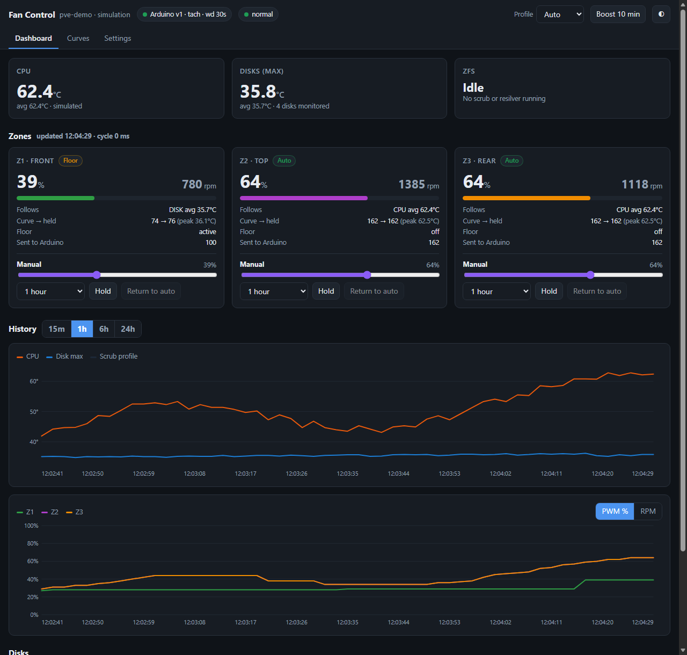
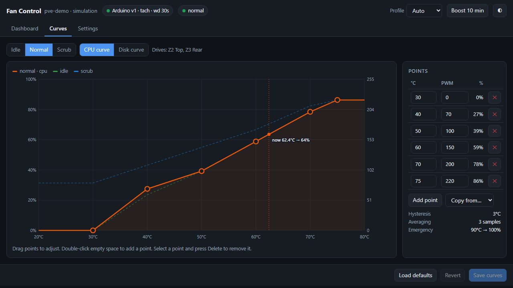

# Proxmox Fan Control

[](https://github.com/bristolpie/ProxmoxFanControl/actions/workflows/build.yml)

Temperature-driven fan control for a Proxmox / ZFS server, using an Arduino Nano as a 3-zone 25 kHz PWM controller over USB. Includes a web dashboard for live temps, fan speeds, history graphs, curve editing and manual overrides.



- **3 fan zones.** Each zone follows a CPU or disk temperature curve, with linear interpolation between points.
- **Hysteresis, rolling averages and cross-zone floors.** Fans don't hunt up and down, and hot disks can lift the CPU fans (and the other way round).
- **Profiles.** `normal`, a `scrub` profile that switches on automatically during a ZFS scrub or resilver, and an optional `idle` profile.
- **Safety.** Emergency temperature thresholds put every fan at full speed, even over a manual setting. A sensor that can't be read falls back to a safe PWM. The Arduino ramps the fans up on its own if the host goes silent (watchdog).
- **Web UI.** Live dashboard, 24 h history, a drag-and-drop curve editor, per-zone manual hold with timeout, and settings.
- **Fan RPM.** Read from the fans' tach wires (optional).
- **No dependencies.** Python 3 standard library only, which Proxmox already has. Also exposes a JSON API and a Prometheus `/metrics` endpoint.



---

## Quick install

On the Proxmox host, as root:

```bash
git clone https://github.com/bristolpie/ProxmoxFanControl.git
cd ProxmoxFanControl
./install.sh          # install the service + web UI
./flash.sh --release  # flash the Arduino firmware (see below)
```

Then open `http://<proxmox-ip>:8090/`.

The installer:

1. Checks for `python3`, `smartctl` and a CPU hwmon sensor. It offers to install `smartmontools` if it's missing.
2. Finds the Arduino under `/dev/serial/by-id/…`, which is more stable than `/dev/ttyUSB0`.
3. Checks whether another program already holds that serial port and offers to stop and disable its systemd service. Only one program can talk to the Arduino.
4. Copies the program to `/opt/proxmox-fancontrol/` and creates `/etc/proxmox-fancontrol/config.json`.
5. Installs, enables and starts `proxmox-fancontrol.service`, then checks that it responds.

Re-run `./install.sh` after a `git pull` to upgrade. Your config is kept.

| Command | Does |
|---|---|
| `./install.sh --port 9000` | Use a different web port (first install only) |
| `./install.sh --yes` | Don't ask any questions |
| `./install.sh --uninstall` | Remove the service and program, keep the config |
| `./install.sh --uninstall --purge` | Also remove the config and history |

Day to day:

```bash
systemctl status proxmox-fancontrol
journalctl -u proxmox-fancontrol -f        # one status line per minute, plus any changes
curl -s localhost:8090/api/status | python3 -m json.tool
```

## Flashing the Arduino

You can flash the Arduino straight from the Proxmox host over the same USB cable. You don't need to unplug it or use another PC. `flash.sh` stops the service, flashes, checks that the firmware answers, and starts the service again. The fans run at the firmware default (PWM 50) for the few seconds the Arduino takes to reboot.

| Command | What it does | Installs on the host |
|---|---|---|
| `./flash.sh --release` | Downloads the prebuilt `fan_zone_control.hex` from the latest GitHub release and flashes it | `avrdude` (apt, small) |
| `./flash.sh --hex file.hex` | Flashes a `.hex` you already have | `avrdude` |
| `./flash.sh --build` | Compiles from source on the host, then flashes. Use this if you've changed the sketch | `arduino-cli` + AVR core (~150 MB) |

It tries both the new (115200 baud) and old (57600 baud) Nano bootloaders, so you don't need to know which one your board has. Use `--port` if you have more than one USB serial device.

If the host is a VM with the Arduino passed through, run the script inside the VM. To flash from a PC with the Arduino IDE instead: open `arduino/fan_zone_control`, choose board **Arduino Nano** (for clones, processor *ATmega328P (Old Bootloader)*), and upload.

---

## Hardware

| Zone | Default role | PWM pin | Tach pin | Follows | Floor |
|---|---|---|---|---|---|
| Z1 | Front fans (drive cage) | D9 (Timer1, 25 kHz) | D2 | Disk max temp | CPU > 60 °C → PWM ≥ 100 |
| Z2 | Top fan | D10 (Timer1, 25 kHz) | D3 | CPU temp | Disk > 45 °C → PWM ≥ 90 |
| Z3 | Rear fan | D11 (Timer2, ~31 kHz) | D4 | CPU temp | Disk > 45 °C → PWM ≥ 90 |

- Fans are 4-pin PWM. Power the fans from 12 V (PSU, or the motherboard fan header power). The Arduino drives only the PWM (blue) wire. **Tie Arduino GND to the fan/PSU ground.**
- Tach (green/yellow wire) is optional. Connect **one** fan per zone, and never join several tach wires together. The internal pull-ups are enabled. If RPM reads double or noisy, add a 10 kΩ pull-up to 5 V.
- Zone names, which sensor each zone follows, and the floors can all be changed in **Settings**.

---

## How the control loop works

Every `interval` seconds (default 5):

1. **Read** the CPU package temp from hwmon (`coretemp` "Package id 0", or `k10temp` Tctl on AMD), with `sensors` as a fallback. Read every SATA/SAS disk with `smartctl`. The disk value used is the **hottest** disk.
2. **Average** each sensor over the last `temp_avg_samples` readings (default 3, about 15 s).
3. **Pick the profile.** If `zpool status` shows a scrub or resilver, use `scrub`, and stay there for `scrub_cooldown_cycles` after it ends. Otherwise use `normal`, or `idle` if `profile.idle_load_below` is set and the load is under it. You can also force a profile from the header dropdown.
4. **Apply the curve** for each zone, with **hysteresis**. Fans speed up immediately but only slow down once the temperature has dropped `hysteresis` °C (default 3) below the peak that set the current speed.
5. **Apply the floor.** If the zone's *other* sensor is above its threshold, the zone never goes below the floor PWM. The floor has the same hysteresis.
6. **Overrides, in priority order:** emergency (any raw temp ≥ the emergency threshold → `emergency.pwm` on all zones) > manual hold from the UI > floor > curve.
7. **Send** changed values to the Arduino, then read back `?`. If a value doesn't match (for example after an Arduino reset), resend it. The `?` read also acts as the watchdog heartbeat.

On a clean stop the fans are set to `safe_exit_pwm` (100).

## Configuration

`/etc/proxmox-fancontrol/config.json`. You'll normally edit this from the UI (**Curves** and **Settings** tabs). Changes apply on the next cycle with no restart, except `web.port` and `web.bind`. A backup of the previous version is kept as `config.json.bak`.

| Key | Default | Notes |
|---|---|---|
| `interval` | 5 | Seconds per cycle |
| `temp_avg_samples` | 3 | Rolling average depth |
| `hysteresis` | 3 | °C |
| `scrub_cooldown_cycles` | 3 | |
| `curves.<idle\|normal\|scrub>.<cpu\|disk>` | see `--print-default-config` | Lists of `[temp °C, pwm 0-255]` with temperatures increasing |
| `zones[]` | Z1 disk, Z2/Z3 CPU | `name`, `source`, `floor: {source, above, pwm}` |
| `emergency` | cpu 90, disk 60, pwm 255 | Uses raw (not averaged) temps |
| `sensor_fail_pwm` | 200 | |
| `sensors.include_nvme` | false | NVMe drives run hotter than spinning disks. Adjust the disk curve if you enable this |
| `sensors.skip_standby` | false | `true` = don't spin up sleeping disks to read their temperature |
| `sensors.disk_exclude` | [] | e.g. `["sdd"]` |
| `serial.port` | auto | `/dev/serial/by-id/...` recommended |
| `serial.watchdog_seconds` | 30 | 0 = off |
| `web.bind` / `web.port` | 0.0.0.0 / 8090 | |
| `web.token` | "" | If set, required for any change. Viewing stays open |
| `history.hours` | 24 | Kept in memory and saved to `/var/lib/proxmox-fancontrol/history.json` every 10 min |

Print the full defaults with `python3 /opt/proxmox-fancontrol/fancontrold.py --print-default-config`.

## Security

The UI can change fan speeds, so treat it like any admin page:

- Set `web.token` (Settings → Access token) so only people with the token can make changes.
- Or set `web.bind` to `127.0.0.1` and reach it through an SSH tunnel or reverse proxy: `ssh -L 8090:localhost:8090 root@pve`.
- The emergency thresholds still apply over any manual setting, so a bad setting can't cook the drives.

## Proxmox GUI integration

Modifying the Proxmox web UI's JavaScript breaks on every `pve-manager` update, so this runs as a separate page. Two easy ways to reach it from Proxmox:

- **Node notes.** Datacenter → *your node* → Summary → Notes → Edit, and add `[Fan control](http://<proxmox-ip>:8090/)`. The link then shows on the node summary page.
- **Reverse proxy.** If you already run nginx, Caddy or Traefik (for example in an LXC), proxy to `http://<proxmox-ip>:8090/`. The UI uses relative URLs, so it also works under a sub-path.

For Home Assistant, Grafana and similar tools, use `GET /api/status` (JSON) or `GET /metrics` (Prometheus).

## API

| Method | Path | Body / query |
|---|---|---|
| GET | `/api/status` | Current temps, zones, profile, Arduino state |
| GET | `/api/history?minutes=60&points=600` | Downsampled history (keeps peaks) |
| GET / PUT | `/api/config` | Full config JSON. PUT validates and returns 400 with a message on error |
| POST | `/api/override` | `{"zone": 1\|2\|3\|"all", "pwm": 0-255 or null to release, "minutes": 60 or null}` |
| POST | `/api/profile` | `{"mode": "auto"\|"idle"\|"normal"\|"scrub"}` |
| POST | `/api/reconnect` | Reopen the serial port |
| GET | `/metrics` | Prometheus text format |

If a token is set, send it as the `X-Auth-Token: <token>` header.

## Arduino serial protocol

9600 baud, newline-terminated.

| Command | Reply | Meaning |
|---|---|---|
| `Z1:128` | `OK Z1:128` | Set one zone (0–255) |
| `A:128` | `OK ALL:128` | Set all zones |
| `?` | `Z1:128 Z2:200 Z3:50` | Read back PWM |
| `V` | `VER 1` | Firmware version |
| `R` | `R1:1200 R2:900 R3:0` | Fan RPM per zone |
| `W:30` | `OK W:30` | Watchdog: if no command arrives for 30 s, all zones go to at least PWM 200. `W:0` = off (the default at power-up) |

On power-up all zones run at PWM 50 until the host sets them. If you use your own sketch that only supports `Z`, `A` and `?`, the daemon runs in basic mode (no RPM or watchdog).

## Development

Run the daemon anywhere, including Windows and macOS, with fake sensors and a fake Arduino:

```bash
python3 fancontrold/fancontrold.py --simulate --port 8090
# → http://127.0.0.1:8090/   (config + history go to <tmp>/proxmox-fancontrol-sim/)
```

CI (`.github/workflows/build.yml`) checks the Python and shell scripts, smoke-tests the daemon in simulation mode, and compiles the firmware. Pushing a `v*` tag publishes a GitHub release with `fan_zone_control.hex` attached, which `flash.sh --release` uses.

## Layout

```
fancontrold/fancontrold.py      daemon: control loop, serial, sensors, HTTP API
fancontrold/web/index.html      web UI (single file, no external assets)
arduino/fan_zone_control/       Arduino Nano firmware
systemd/                        service unit
install.sh                      installer / uninstaller
flash.sh                        flash the firmware from the host
```

## License

[MIT](LICENSE)
